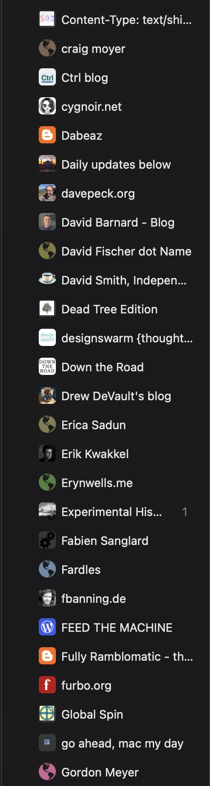

slug: read-blogs
published: Mon, 09 Nov 2026 at 04:46 PM
updated: Mon, 09 Nov 2026 16:46:12 
title: Read Blogs
author: Brian Schrader
status: publish
tags: blogging
showfootercallout: true
summary: In a Web where content is poisoned, return to the source of it all. The blog still welcomes you. The water is sweet.

I was reading [a random blog post][2] the other day, after watching a video about [how social media platforms incentivize rage bait content][1] and suddenly a thought hit me.

  
  
<small>A small sample of the 300+ blogs I currently follow.</small>

I think, out of most of the people I know, I manage to see the least rage bait. Why is that?

I think it's because, unlike most people these days, I read blogs not social media. I read the news, of course, and that makes me mad. But the news isn't the same thing. I don't see the kinds of bizarro-world content that proliferates on Instagram, Facebook, Twitter, etc. because I just don't spend time on algorithmic social media.

I watch a lot of YouTube, but it's almost entirely videos made by a carefully curated list of creators I've subscribed to for years. I [rarely trust][6] new channels these days. Other than that, I read the news, I read magazines, and I read blogs.

Want to read more blogs yourself? Put these files in your RSS reader:

- Try [these Indie Bloggers](/dropzone/rss-starter-packs/indie-bloggers.opml)
- or [these all-time classics](/dropzone/rss-starter-packs/internet-favorites.opml)
- or [these history blogs](/dropzone/rss-starter-packs/history.opml)

Like tech? I read Hacker News, but [only certain parts of it](https://hnrss.org/newest?points=80&comments=20). You can do that [here](https://hnrss.org/). Use [Lobste.rs][5] or [Blogroll.org][4] to find stuff. [Bubbles.town][3] has been a recent addition, and I love it.

Find yourself reading a blog? Follow them! Use [NetNewsWire](https://netnewswire.com) or any other RSS reader. There's tons these days. I know because I see them pinging this very site every day, including a new one I found while writing this post!

Blogs are great. I've said that for years. People blog about the most fascinating and mundane topics. They think through problems. They reply to each other's posts! There's no algorithm, and the level of shitposting is held within control because losing followers matters. People *opt-in* to blogs. Piss them off and they leave.

Don't like RSS? Join the newsletter. The protocol doesn't matter. The blogs do.

Read blogs. Find them, subscribe to them, and then read them. They're great. They're the way the web not only *should be* but how it's *supposed to be*. The blogs are just better.

Read them.

[1]: https://www.youtube.com/watch?v=zCvPPaIN5Ew
[2]: https://michaelheap.com/i-dont-want-the-details/
[3]: https://bubbles.town
[4]: https://blogroll.org
[5]: https://lobste.rs
[6]: /archive/gatekeepers-are-dead-long-live-the-gatekeepers/
